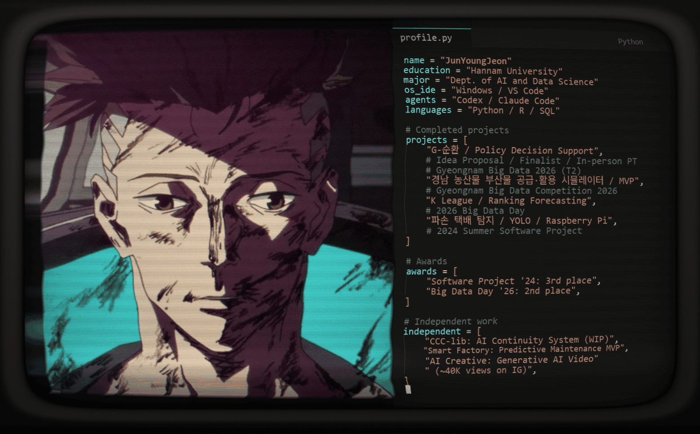

<picture>
  <source media="(prefers-reduced-motion: reduce)" srcset="https://raw.githubusercontent.com/rusoacn/rusoacn/331bb7637248966f4b47bf5365a1426ce462943a/assets/profile-artisanal.png">
  
</picture>

<!-- Image URLs are pinned to the published animation revision to avoid stale caches. Rebuild using scripts/render_artisanal.py, then update both image URLs to the new asset commit. The preceding ASCII SVG assets are retained for rollback. -->

<!-- Selected projects and credentials are owner-provided; project internals remain private. Historical statistics retained in the source record are not displayed in the current artwork. Statistics are snapshots as of 2026-11-26, not live statistics. Repository count includes owned public and private repositories. Contribution count refers to the preceding year, as shown in the owner-provided GitHub screenshot. AI usage figures are transcribed from the owner-provided usage screenshot (total 36.48 billion tokens, peak 1.96 billion tokens, longest session 1d 2h, best streak 33d, current streak 22d); the peak interval is unspecified. Token usage measures activity, not software output. The commit and line-change totals are the 2026-11-26 snapshot for authored commits associated with the account across 14 owned repositories' default branches. Net Lines equals additions minus deletions, including data files, archives, logs and documents, and does not measure manually written source code. The user-supplied anime frame is transformed with deterministic analog film processing; no generated portraits or inferred identity. The previous avatar source is retained in repository history. G-순환 is an idea proposal; the agricultural by-product simulator is an MVP. The approximate single-video view count is self-reported in an August 2026 record; live Instagram Insights and the all-time maximum are unverified. Gyeongnam Track 2 finalist status is not an award. Track 1 is a separate submission. The 2024 third-place result is based on the team record; the formal award title is unverified. The 2026 Big Data Day result and two-team field are owner-reported. -->
